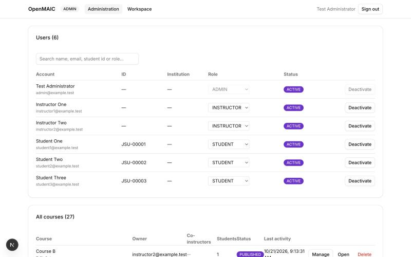

# Administrator Manual

**OpenMAIC teaching platform — Level 2**

An administrator manages accounts and can see every course. Everything here is done at
`/platform`, which sends you to the administrator dashboard automatically.

---

*The administrator dashboard: every account with its role and status, searchable, and every course
on the platform with its owner, co-instructors and student count. Manage opens the same panel the
instructor uses, on any course, which is how an administrator enrols a student or assigns an
instructor. Your own row is switched off, so the last administrator cannot demote themselves.*

## Signing in

Go to `/platform`. If you are not signed in you are sent to the sign-in page. Enter your email and
password; the platform decides which dashboard you belong to from your account, not from the
address you type, so there is no separate administrator URL to remember.

A shared access code is **not** used. Your account is the credential.

---

## Approving a new account

Someone who signs in for the first time without having been provisioned gets an account in
**PENDING** state, and is refused until you approve it. Pending accounts appear in a panel at the
top of your dashboard.

For each one, choose the role to approve them as:

- **Approve as STUDENT** — can open courses they are enrolled in, nothing more.
- **Approve as INSTRUCTOR** — can create courses and manage their own students.
- **Approve as ADMIN** — full platform administration.

Approving sets the role and marks the account ACTIVE in one step.

---

## Managing users

The **Users** table lists every account with its role, institution, student identifier and status.

- **Change a role** with the dropdown in the Role column. The change takes effect on that person's
  next request.
- **Activate or deactivate** with the button at the end of the row. A deactivated account cannot
  sign in to anything: every API call it makes is refused.

**Two things you cannot do, by design.** You cannot change your own role, and you cannot deactivate
your own account. Both are refused by the server as well as hidden in the interface. Without that,
the last administrator could demote themselves and leave the platform with nobody able to
administer it.

---

## Seeing every course

The **All courses** table lists every course on the platform with its owner, co-instructors,
student count, status and last activity. **Open** takes you into the classroom.

As an administrator you also reach every course-scoped function an instructor has — the student
list, the results, the export — without being added to the course. There is no separate
administrative screen for these; use the same addresses the instructor does.

---

## Creating accounts directly

Accounts can also be created without waiting for someone to sign in. The project script
`scripts/level2-seed-test-accounts.mjs` creates a set of accounts with profiles; for a classroom
pilot, adapt the account list at the top of that file. Passwords are written to
`.env.level2-test-accounts`, which is excluded from version control.

---

## What an administrator should know about the data

- Learner interaction is stored by OpenMAIC, keyed by course and by the learner's account.
- Nothing is duplicated into platform tables, so there is one copy of each record.
- Exports never contain passwords, API keys, tokens or database credentials.
- Database backups (`scripts/level2-db-backup.sh`) contain **password hashes and session rows**.
  Treat those files as credentials; they are excluded from version control.

---

# Level 3 — research administration

Everything below is on the same Administrator page, under the users and courses tables.

## Institutions

An institution groups people and course sections, so that one module can be run at several places
and the data stay separable. **An institution grants nobody access to anything.** Course permission
is still ownership and enrolment, and belonging to the same institution as a course opens nothing.

To add one, type its name and a short name — "Jackson State University", "JSU" — and press **Add
institution**. The short name must be unique; it is what appears in research exports.

A person's institution is set on their profile. The accounts seeded for testing already have one.

## Studies

A study is a piece of research: a title, a protocol identifier, a principal investigator, and the
course sections it covers.

**Create study** with a title, and optionally the email of the principal investigator — who must
already have an account. The study starts as `DRAFT`; it holds data regardless of status.

Press **Manage** on a study to do the two things that matter.

### Adding a section, and its condition

Choose a course section and give it an **experimental condition** — `CONDITION-A`, `AI_FEEDBACK`,
whatever your design calls for. The platform does not check the label against any list, because the
instruction is explicit that researchers define their own.

A section with no condition will be reported as a data-quality failure on the researcher's page,
because a section without a condition cannot be analysed as one.

Adding a section to a study **does not change who teaches it or who is enrolled**. It only says
that this section's events belong to this study.

### Registering participants and recording consent

Type a student's email and choose a consent status. The platform allocates a research identifier —
`P-00001`, `P-00002` — and from then on that is how the person appears in every export.

| Status | What it means |
|---|---|
| `NOT_REQUESTED` | nobody has asked them yet. The default |
| `PENDING` | asked, no answer yet |
| `CONSENTED` | **the only status whose data appear in an export** |
| `DECLINED` | they said no |
| `WITHDRAWN` | they consented and later withdrew |

**Instructional access and research inclusion are separate.** A student uses the platform for their
course whatever their consent status; consent decides only whether they are in anybody's dataset.

You are the only role that can see which person a participant identifier belongs to. A researcher
sees `P-00001` and no more.

## Researchers

Give an account the `RESEARCHER` role in the users table. That role **carries no course permission
at all** — a researcher cannot open, edit or enrol in any course.

Holding the role is not access to anything by itself: a researcher sees only the studies they lead
or were explicitly added to.

## The audit log

Every administrative action is recorded, append-only, in `audit_log`: who did it, what, to what,
when. It covers account creation, role changes, course deletion, template publication and cloning,
enrolment, study changes, consent changes and **every data export**.

It never contains a password, a token or an API key, and there is an automated check that proves it.
