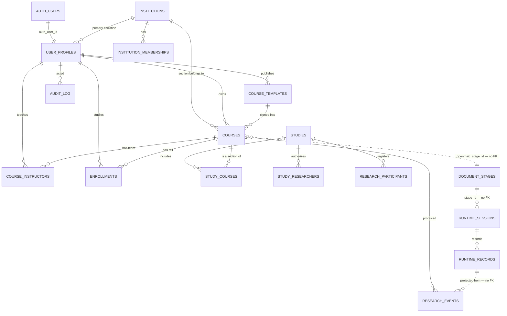

# Database schema — the whole platform

**Duy Nguyen · 22 October 2026 · Levels 2, 3A, 3B, 3C and 3D**

Three groups of tables share one PostgreSQL database and are deliberately not joined by foreign
key across the boundaries:

- **OpenMAIC's own** — `document_stages`, `document_scenes`, `runtime_sessions`, `runtime_records`,
  `stage_meta` and the rest. We **read** these and never alter them.
- **Level 2** — identity, courses, people.
- **Level 3A** — institutions, templates, studies, research data.

The join from our tables to OpenMAIC's is by value: `courses.openmaic_stage_id` and
`runtime_sessions.stage_id`. No foreign key crosses, so OpenMAIC can migrate its storage without
breaking ours — which is the single decision that kept the upstream delta at seven files.

## Level 2

| Table | Key columns | Notes |
|---|---|---|
| `user_profiles` | `auth_user_id` → Supabase, `email`, `role`, `external_identifier`, `status`, `primary_institution_id` | `role` is `ADMIN / INSTRUCTOR / STUDENT / RESEARCHER`. `external_identifier` is the institutional student number (`JSU-00001`) and is **not** a research identifier |
| `courses` | `openmaic_stage_id` unique, `title`, `owner_instructor_id`, `status`, `template_id`, `template_version`, `institution_id`, `configuration_snapshot` | `status` is `DRAFT / PUBLISHED / ARCHIVED`. Archiving is what deletion does when learner work exists |
| `course_instructors` | `(course_id, instructor_id)`, `permission` | `OWNER / EDITOR / VIEWER`. A partial unique index allows **one owner per course**, and the API refuses to demote that owner |
| `enrollments` | `(course_id, student_id)`, `status` | `ACTIVE / INACTIVE / COMPLETED`. Removal sets INACTIVE so the learner's records stay attributable |

**Indexes that matter:** `courses (owner_instructor_id, lower(title)) WHERE status <> 'ARCHIVED'` —
one course name per instructor; `course_instructors (course_id) WHERE permission = 'OWNER'` — one
owner.

## Level 3A

| Table | Key columns | Notes |
|---|---|---|
| `institutions` | `name`, `short_name` unique, `country`, `institution_type` | Groups people and sections. **Grants nothing** |
| `institution_memberships` | `(institution_id, user_id)`, `role` | Further affiliations beyond the primary one |
| `course_templates` | `title`, `version`, `source_stage_id`, `created_by`, `visibility`, `status` | Unique on `(created_by, lower(title), version)` — a design at a version is immutable |
| `studies` | `title`, `principal_investigator`, `protocol_identifier`, `status`, dates | |
| `study_courses` | `(study_id, course_id)`, `experimental_condition`, `cohort_label` | Condition labels are free text by instruction |
| `study_researchers` | `(study_id, user_id)`, `role` | `RESEARCHER / DATA_MANAGER / OBSERVER`. Access to a study, never to a course |
| `research_participants` | `(study_id, user_id)` unique, `participant_id` unique per study, `consent_status` | **The only place a person and `P-00031` appear together** |
| `research_events` | `source_runtime_record_id` **unique**, `study_id`, `course_id`, `learner_id`, `event_type`, `event_timestamp`, `structured_payload` | The unique column is what makes projection idempotent |
| `audit_log` | `actor_id`, `action`, `target_type`, `target_id`, `metadata` | Append-only by convention: nothing updates or deletes a row |

## Level 3B

| Table | Key columns | Notes |
|---|---|---|
| `rubrics` | `title`, `version`, `created_by`, `status` | Unique on `(created_by, lower(title), version)` — immutable once published |
| `rubric_dimensions`, `rubric_levels` | `(rubric_id, dimension_id)` | What is judged, and what each score means |
| `rubric_assignments` | `(course_id, activity_id)` unique, `rubric_version`, `feedback_policy` | The version is copied, not referenced |
| `learner_responses` | `(course_id, learner_id, activity_id, attempt_number)` unique, `parent_attempt_id` | A revision is a new row, never an update |
| `assessments` | `response_id`, `assessor_kind`, `model`, `prompt_version`, `raw_result` | `AI` and `HUMAN` rows coexist; neither overwrites the other |
| `assessment_scores` | `(assessment_id, dimension_id)`, `evidence`, `confidence` | |
| `assessment_reviews` | `ai_assessment_id`, `human_assessment_id`, `decision` | The record of a decision, not an edit |
| `feedback_events` | `response_id`, `kind`, `policy`, `model`, `shown_at` | Every generated piece, shown or not |

## Level 3C

| Table | Key columns | Notes |
|---|---|---|
| `knowledge_resources` | `type`, `version`, `visibility`, `connection` | The type chooses the retriever. `connection` can hold a remote graph service's details without anything above knowing what they are |
| `knowledge_documents`, `knowledge_chunks` | `embedding vector(1536)` | HNSW index for cosine distance; a gin trigram index for keyword |
| `knowledge_graph_edges` | `subject`, `predicate`, `object` | One implementation of the graph retriever, not the only possible one |
| `knowledge_attachments` | `(scope, scope_id, source_name)` unique, `priority`, `retrieval_policy` | The researcher's own label, never interpreted |
| `agent_configurations` | `name`, `version`, `permitted_resources` | Versioned. `permitted_resources` is a bound enforced at retrieval |
| `retrieval_events` | `request_id`, `provider`, `chunk_id`/`edge_id`, `score` | One row per passage actually handed to a model |

Extensions enabled by `0005`: **`vector`** (0.8.2) and **`pg_trgm`**.

## Level 3D

| Table | Key columns | Notes |
|---|---|---|
| `response_media` | `response_id`, `kind`, `bytes` | The student's original, kept whatever the extraction did. `bytea` for the prototype; object storage in production |
| `processing_jobs` | `kind`, `status`, `attempts` | A durable queue. Claimed with `FOR UPDATE SKIP LOCKED` |
| `model_usage` | `stage`, `model`, tokens, `estimated_cost` | One row per call. Tokens nullable — a provider that reports nothing leaves them empty |
| `lms_integrations` | `provider`, LTI 1.3 fields, `status` | A boundary. `MANUAL` is the only implemented provider |
| `lms_course_links` | `(integration_id, course_id)` unique | |
| `lms_grade_postings` | `response_id`, `score`, `status` | `PREPARED` unless an adapter actually sent it |

## Row-level security

Every table in every level has RLS **enabled with no policies**, and `anon` and `authenticated` are
revoked. Nothing reaches them except the server's own connection.

This is defence in depth and not the fence. The fence is the authorization check in each route
(`docs/AUTHORIZATION_MODEL.md`); RLS is the wall behind it, so that a mistake in a route cannot be
read directly through the public Supabase key.

## What is not in the database

- **Learner chat, quiz and PBL content.** It lives in OpenMAIC's `runtime_records`, and
  `research_events` references it rather than copying it.
- **Credentials.** No password, token or API key is stored in any table here, and the audit log is
  tested for it.
