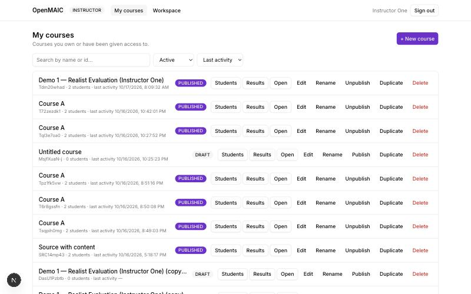
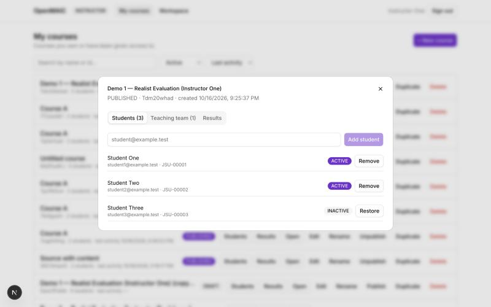
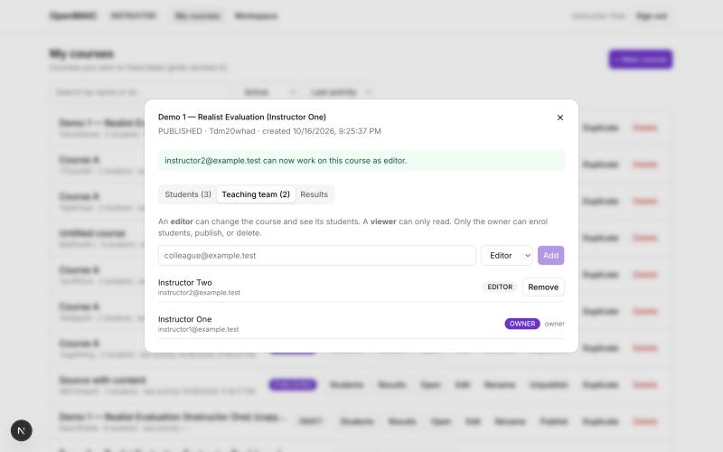

# Instructor Manual

**OpenMAIC teaching platform — Level 2**

---

*The instructor dashboard. One row per course with its id, how many students are on it and when it
was last used; search, a status filter and a sort above; and on each row Students, Results, Open,
Edit, Rename, Publish, Duplicate and Delete. "+ New course" opens the OpenMAIC workspace, where a
course you make becomes yours automatically.*

*Clicking Students opens everything about that course over the page. Add a student by email;
Remove turns their access off without destroying their work, and Restore turns it back on.*

*The second tab shares a course with a colleague. An editor can change the course and see its
students; a viewer can only read. Only the owner can enrol students, publish or delete, and the
owner cannot be removed or demoted here — handing a course over is a separate, deliberate act.*

## Signing in

Go to `/platform` and sign in with your email and password. You land on your instructor dashboard.
There is no shared access code; your account is the credential.

---

## Creating a course

Courses are created in the OpenMAIC workspace, as before: open the workspace from **Open workspace**
on your dashboard (or go to `/`), describe what you want taught, and let OpenMAIC generate it.

The course becomes **yours** automatically — you are recorded as its OWNER in the same transaction
that creates it. Nobody else can see it until you publish it and enrol students.

A new course starts as a **draft**. Students cannot open a draft even if they are enrolled, which
gives you room to prepare it.

---

## Your course list

Each course shows its title, status, number of students, co-instructors and last activity, with
five actions:

| | |
|---|---|
| **Edit** | open the course in the OpenMAIC editor |
| **Open classroom** | enter the classroom yourself, as a learner would see it |
| **Manage students** | the enrolment roll |
| **Results** | what your students have done |
| **Duplicate** | make a copy for another section |
| **Publish / Unpublish** | make the course available to enrolled students, or withdraw it |

---

## Enrolling students

**Manage students** opens the roll. Type a student's email and press **Add student**.

Two rules the platform enforces:

- The person must already have an account. Enrolment does not create accounts; ask an administrator
  to create one.
- The account must be a **STUDENT**. An instructor or administrator account cannot be enrolled as a
  learner.

**Deactivate** removes a student's access immediately — on their very next request, not when some
cache expires. The enrolment row is kept rather than deleted, so their existing work stays
attributable; **Reactivate** restores access.

### A student can open your course only when all of this is true

They are signed in, they have an **ACTIVE** enrolment, and the course is **PUBLISHED**. Leave any
one out and they are refused. If a student reports they cannot get in, check the course is
published before anything else — that is the usual cause.

---

## Seeing what students have done

**Results** lists every enrolled student with their session count, number of interactions, the kinds
of activity recorded, and when they were last active.

**View trajectory** on a row opens that student's chronological record: each event with its
timestamp, what the student wrote, and what the AI replied.

You see this only for courses you are authorised on. A request for another instructor's course is
refused outright — you are not shown a filtered empty list that might be mistaken for "no activity".

---

## Exporting

**Export CSV** and **Export JSON** on the Results panel download everything recorded for that
course.

The columns are: course id and title, student identifier and internal id, student email, activity
id and type, session kind, sequence, timestamp, learner input, agent response, and the untouched
payload. Quiz and PBL columns are present but **empty** — this deployment has not yet produced
records of those kinds, and the platform does not invent values it does not have.

Exports never contain passwords, API keys or credentials.

---

## Sharing a course with a colleague

Add a co-instructor through the course's instructors endpoint as **EDITOR** (may edit the course and
inspect students) or **VIEWER** (may look, not change). Only you, the OWNER, can add or remove
co-instructors, publish, or delete.

Removing a co-instructor takes effect immediately: the course disappears from their list and their
API access fails on the next request.

---

## Duplicating a course for another section

**Duplicate** makes an independent copy:

- the original is untouched;
- the copy gets a new id and starts as a **draft**;
- **no student data is copied** — no enrolments and no learner interaction;
- you are the OWNER of the copy.

This is how to run the same material with a second group without the two sharing results.

---

# Level 3 — sharing a module, and running somebody else's

At the bottom of **My courses** there is a **Shared modules** panel. It does two different things.

## Publishing one of your courses as a module

Press **Publish one of my courses**, choose the course, give it a **version** and a **visibility**:

| Visibility | Who can see and clone it |
|---|---|
| `PRIVATE` | only you |
| `INSTITUTION` | anyone at your institution |
| `COMMUNITY` | every instructor on the platform |
| `ADMIN_ONLY` | administrators only |

Publishing shares **the instructional design**, never your class. Nobody gains access to your
course, your students or their work by seeing your module.

### Versions, and why they matter

Publishing the same title at the same version twice is refused. To change a design, publish a new
version — `1.1`, `2.0`. Sections already cloned keep pointing at the version they were made from,
which is what lets a study that is running stay comparable.

## Running a module somebody else published

Press **Use this module**. You get a course of your own:

- a **new course id**;
- **you** as its owner;
- **no students** — the roll starts empty;
- **no learner data of any kind** from the original or from anyone else's section;
- a record of which module and version it came from, and a snapshot of the configuration at that
  moment, so a researcher can reconstruct later what your students experienced.

It arrives as a draft. Add your students and publish it exactly as you would any course.

Three instructors at three institutions can run the same module at the same time, and each sees
only their own students. That is the entire point of this level, and it is tested rather than
asserted.

## If your course is part of a study

An administrator can add your section to a research study and give it an experimental condition.
That changes nothing about your teaching, your roll or your access.

It does mean a researcher authorized for that study can read **de-identified** data from your
section: participant identifiers, not names. You keep the identified view of your own students;
they never get it.

Being an instructor on a study's section does **not** give you access to the study, and you cannot
export it — that is deliberate, and tested.
