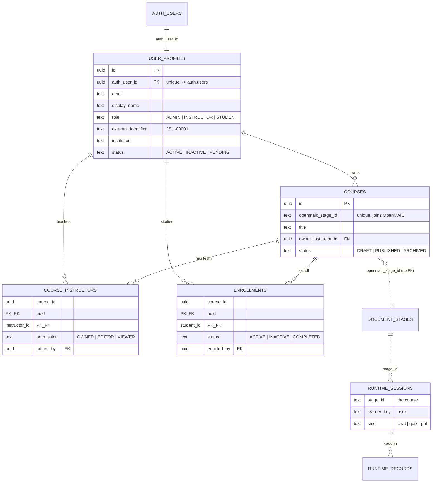

# Level 2 — Database Schema

**Duy Nguyen · 2026-10-16 · migration `db/migrations/0001_level2_rbac.sql` (applied)**

Four tables carry Level-2 identity and authorization. They live in the same database as
OpenMAIC's own tables, for the reason given in
[LEVEL2_ARCHITECTURE_AUDIT.md](LEVEL2_ARCHITECTURE_AUDIT.md) §9: the `onCreate` persistence hook
runs inside OpenMAIC's course-creation transaction and hands us that transaction, so a course and
its ownership row must be able to commit together.

---


## Entity relationship diagram

The instruction asks for one. Four tables are ours; `auth.users` belongs to Supabase and
`document_stages`, `runtime_sessions` and `runtime_records` belong to OpenMAIC. **No foreign key
crosses into OpenMAIC's tables** — the join is by `openmaic_stage_id`, so OpenMAIC can migrate its
own storage without breaking ours, which is the whole reason the level could be built in seven
files.



**The two rules the diagram cannot show.**

1. A partial unique index on `course_instructors (course_id) WHERE permission = 'OWNER'` allows
   exactly one owner per course. Since 2026-10-21 the API also refuses to demote that owner, after
   an owner locked themselves out of their own course by offering their own address to the
   co-instructor endpoint.
2. `learner_key` is always `'user:' || auth_user_id`, derived on the server from the session. The
   browser never supplies it, which is what makes a learner record attributable at all.


## 1. Entity relationships

```
                       Supabase auth schema (27 tables, managed by Supabase)
                                    auth.users
                                        |
                                        | auth_user_id  (FK, ON DELETE CASCADE)
                                        v
   +--------------------------------------------------------------------+
   |  user_profiles                                                      |
   |  id · auth_user_id · email · display_name · role · status           |
   |  external_identifier · institution · created_at · updated_at        |
   |  role:   ADMIN | INSTRUCTOR | STUDENT                               |
   |  status: ACTIVE | INACTIVE | PENDING                                |
   +--------------------------------------------------------------------+
        |                       |                         |
        | owner_instructor_id   | instructor_id           | student_id
        v                       v                         v
   +------------------+   +----------------------+   +--------------------+
   |  courses         |   |  course_instructors  |   |  enrollments       |
   |  id              |<--|  course_id           |   |  course_id         |-->(courses)
   |  openmaic_       |   |  instructor_id       |   |  student_id        |
   |    stage_id (U)  |   |  permission          |   |  status            |
   |  title           |   |  added_by            |   |  enrolled_at       |
   |  owner_          |   |  created_at          |   |  enrolled_by       |
   |    instructor_id |   |  PK(course,instr.)   |   |  PK(course,student)|
   |  status          |   |  OWNER|EDITOR|VIEWER |   |  ACTIVE|INACTIVE|  |
   |  created/updated |   |  exactly one OWNER   |   |    COMPLETED       |
   +------------------+   +----------------------+   +--------------------+
            |
            | openmaic_stage_id  — soft reference, no FK (see §3)
            v
   ................................................................
   :  OpenMAIC's own 17 tables, unchanged                         :
   :  stage_meta (stage_id, owner_id, is_public, published_at …)  :
   :  document_stages / document_scenes / document_outlines       :
   :  runtime_sessions (stage_id, learner_key, kind, …)           :
   :  runtime_records  (session_id, seq, scene_id, data)          :
   ................................................................
```

---

## 2. Why these four and nothing more

The instruction's own suggested structures, implemented as given. Nothing was added speculatively.

| Table | Purpose | Instruction |
|---|---|---|
| `user_profiles` | One row per authenticated account; role and status are authoritative | *"Create a secure server-side user profile model"* |
| `courses` | Application metadata for an OpenMAIC course — **not** a copy of it | *"Do not duplicate the full OpenMAIC course document in this table"* |
| `course_instructors` | Who may act on a course and how | *"may share a course with authorized co-instructors"* |
| `enrollments` | Which students may open which course | *"Student sees only courses in which they are enrolled"* |

Learner interaction data is **not** modelled here. The audit (§5) established that OpenMAIC's
`runtime_sessions` / `runtime_records` already carry course, learner, activity kind, scene and an
ordered sequence, which is what the instruction asks for. Duplicating it is explicitly forbidden:
*"Do NOT create another competing table system unless OpenMAIC lacks the required data."*

---

## 3. Three design decisions worth stating

**No foreign key into OpenMAIC's tables.** `courses.openmaic_stage_id` references
`stage_meta.stage_id` logically, but no FK is declared. OpenMAIC runs its own migrations at
start-up and owns that schema; a hard FK would tie our migration order to theirs and would break on
an upstream change. The column is `UNIQUE`, so one course row per stage is still guaranteed, and
the application reconciles the pair. This keeps the upstream delta at zero for the database.

**Exactly one OWNER per course**, enforced by a partial unique index rather than by application
code:

```sql
CREATE UNIQUE INDEX course_instructors_one_owner
  ON course_instructors (course_id) WHERE permission = 'OWNER';
```

A second OWNER row is rejected by the database. Co-instructors are `EDITOR` or `VIEWER`, which is
what the instruction describes: *"OWNER … can add/remove co-instructors"*.

**Row-level security is enabled with no policies.** The application reaches these tables over a
direct Postgres connection, so RLS does not govern our own queries — authorization is server-side,
in the application, as the instruction requires (*"Enforce every permission server-side"*). RLS is
switched on anyway and `anon` / `authenticated` are revoked, so a browser holding the Supabase
publishable key cannot read these tables through the auto-generated PostgREST API. It is a second
fence, not the fence.

---

## 4. Constraints, verified by running them

| Rule | Mechanism | Verified |
|---|---|---|
| `role` ∈ ADMIN, INSTRUCTOR, STUDENT | CHECK | ✅ `role='SUPERUSER'` → `check_violation` |
| `status` ∈ ACTIVE, INACTIVE, PENDING | CHECK | ✅ `status='BANNED'` → `check_violation` |
| `permission` ∈ OWNER, EDITOR, VIEWER | CHECK | ✅ constraint present |
| `courses.status` ∈ DRAFT, PUBLISHED, ARCHIVED | CHECK | ✅ constraint present |
| One profile per account | `auth_user_id` UNIQUE | ✅ |
| One email per account, case-insensitive | unique index on `lower(email)` | ✅ |
| One course row per OpenMAIC stage | `openmaic_stage_id` UNIQUE | ✅ |
| One OWNER per course | partial unique index | ✅ index present with the right predicate |
| Deleting an account removes its profile | FK `ON DELETE CASCADE` to `auth.users` | ✅ |
| An instructor who owns a course cannot be deleted silently | FK `ON DELETE RESTRICT` | ✅ |
| `updated_at` maintained | BEFORE UPDATE trigger | ✅ |

RLS confirmed enabled on all four tables.

---

## 5. How identity connects to OpenMAIC

OpenMAIC stores an opaque `owner_id` on every owned object, and the core *never* interprets its
shape (audit §3). Level 2 mints it from the authenticated account:

```
Supabase session  →  auth.users.id (uuid)  →  ownerId = "user:<auth_user_id>"
                                              ↓
                                        stage_meta.owner_id
                                        runtime_sessions.learner_key
```

Because the same value becomes both the course owner id and the learner key, the isolation
OpenMAIC already enforces (`403 FORBIDDEN_DOCUMENTS`, `403 FORBIDDEN_LEARNER` — audit §4, §6)
becomes per-account isolation the moment the auth method is registered. No isolation logic is
written by us.

Courses created before Level 2 belong to `anon:<uuid>` owners and will therefore have no account
owner. This does not affect the Level-1 deployment, which runs on its own separate database.

---

## 6. What Level 3 will add, and why it is not here

Recorded so the next level extends rather than rewrites. From `instruction …-v3.docx`:

- `institutions` + `institution_memberships` — Level 2 keeps `user_profiles.institution` as a text
  label, which is the migration source.
- `course_templates`, versioning, cloning — Level 2 provides a plain Duplicate Course only.
- `studies`, `study_courses`, experimental conditions.
- `research_events`, `research_participant_id` separate from identity.
- `rubrics`, `rubric_dimensions`, `rubric_levels`, AI/human scores.
- `knowledge_resources` and the `KnowledgeProvider` abstraction.

None of it is built now. The instruction is explicit: *"Do not begin Level 3 unless Level 2
authentication, course authorization, student-data isolation, and API security tests have passed."*
