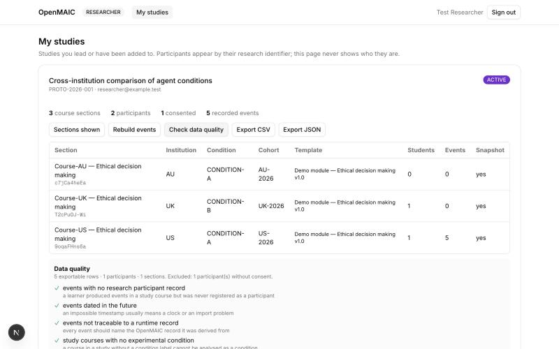

# Researcher Manual

**OpenMAIC research platform · Level 3A · 21 October 2026**

You have a RESEARCHER account. This page is everything it can do, and is honest about what it
cannot.

## What a researcher is, and is not

You can read the studies you lead or have been added to: which sections are in them, how complete
the data are, and an export. You **cannot** change a course, see a student's name, or reach a study
nobody added you to. That is deliberate — reading research data does not make anyone a teacher, and
belonging to the same institution as a course grants nothing.

## Signing in

Open the platform and sign in. You land on **My studies**. There is no sign-up: an administrator
creates accounts and adds researchers to studies.

Each study shows its protocol identifier, who the principal investigator is, how many sections it
covers, how many participants are registered, **how many of those consented**, and how many events
have been recorded.

## Looking at a study

**Show sections** lists the course sections in the study:

| Column | What it tells you |
|---|---|
| Section | the section's name, and its course id — the unit your data are separated by |
| Institution | which institution it belongs to |
| Condition | the experimental condition. **Missing** in red is a problem: a section without one cannot be analysed as a condition |
| Cohort | the label the administrator chose |
| Template | the shared module and the version this section was cloned from |
| Students | how many are enrolled |
| Events | how many recorded events exist |
| Snapshot | whether the configuration at clone time was captured. **no** in red means what the students experienced cannot be reconstructed later |

## Rebuilding the events

**Rebuild events** reads OpenMAIC's own runtime records and projects them into research events. It
is safe to press at any time: running it twice writes nothing the second time, and it never
touches the records it reads.

It reports how many it examined, how many it wrote, and **how many it skipped because they are of
a kind the platform does not map yet**. That last number is not a failure; it is the platform
refusing to invent an event type it does not understand.

## Checking the data before you use them

**Check data quality** runs five checks and shows which fail. Read it before an analysis, not
after. It also says how many participants were excluded because they have not consented.

## Exporting

**Export CSV** or **Export JSON**. Every column is listed in `docs/DATA_DICTIONARY.md`.

Three things to know:

1. **No export contains an email, a name, or a student number.** People appear as `P-00031`. The
   table linking a participant id to a person exists, and an administrator can read it; you cannot.
2. **Only consented participants are included.** Somebody using the platform for their course is
   not thereby in your dataset.
3. **Every export is recorded in the audit log** — who, which study, which format, how many rows.

## What this level does not have yet

So that no analysis is planned around something that does not exist:

- **No rubric scoring, AI assessment or human override.** That is 3B.
- **No feedback or revision events**, because no service produces them yet.
- **No quiz or PBL events ever recorded in this deployment.** The projection maps those kinds; no
  course has produced one, so no dataset contains one.
- **No per-response model metadata** — model name, parameters, prompt version. The section's
  configuration at clone time is captured; the per-call detail is not, and arrives with 3B.
- **No knowledge-resource provenance.** That is 3C.
- **No random assignment to conditions.** An administrator sets the condition on each section.

---

# Level 3B and 3C — what is now in your dataset

## Responses, revisions and feedback

Beyond the classroom chat you had in 3A, the dataset now carries:

| Event | What it means |
|---|---|
| `RESPONSE_SUBMITTED` | a student's first answer to an activity |
| `RESPONSE_REVISION` | a later attempt, with the attempt it revises recorded |
| `FEEDBACK_SHOWN` | feedback a student actually saw |
| `FEEDBACK_GENERATED` | feedback that was produced but not shown |

The last two are deliberately different. Measuring whether feedback changed anything needs to know
which feedback reached the learner.

## Assessments: three scores, not one

For each answer there may be an **AI** assessment, a **human** one, or both. Neither overwrites the
other, and the **final** score is derived: the human's when one exists, the AI's when a human
accepted it, and **none** when nobody has looked. An unreviewed AI score is not a final score.

That is what makes AI-versus-human comparison possible at all, and it is why the platform refuses
to collapse them into a single number.

Each assessment carries the model, the prompt version, the rubric version and the **raw model
result**, so a score from today is still interpretable later.

## What a model was given

If a course had knowledge sources attached, every passage handed to the model is recorded: which
source, which document, which chunk or which graph edge, and the retriever's score. The assessment
row names the retrieval request, so reconstructing what the model saw is one join.

Two cautions, meant literally:

- **The score is the retriever's own number** — a cosine distance or a trigram similarity. It is
  not a measure of relevance and not a citation.
- **Nothing records that the model *used* what it was given.** The platform records what was
  provided, which is a different and weaker claim, and it does not make the stronger one.

## Conditions you can now build

Same module, same rubric, and a difference in exactly one thing:

- feedback `ON_REQUEST` against feedback `OFF`;
- an agent bounded to an authoritative corpus against one free to use every source;
- one knowledge source against several.

Each is a condition label on a section, and the configuration snapshot plus the agent and rubric
versions make it reproducible afterwards.
