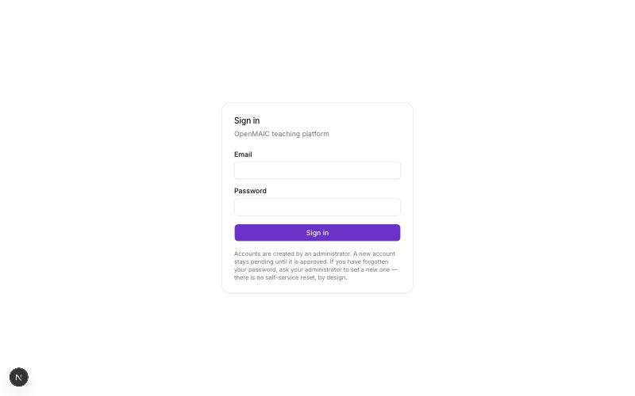
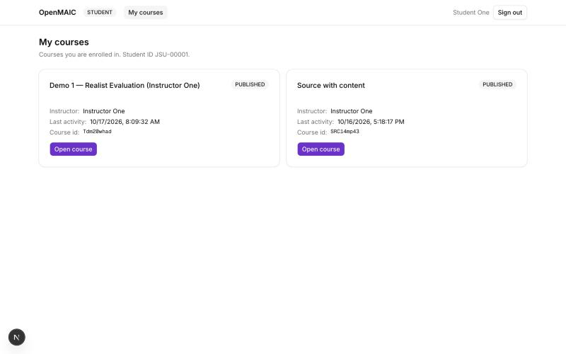
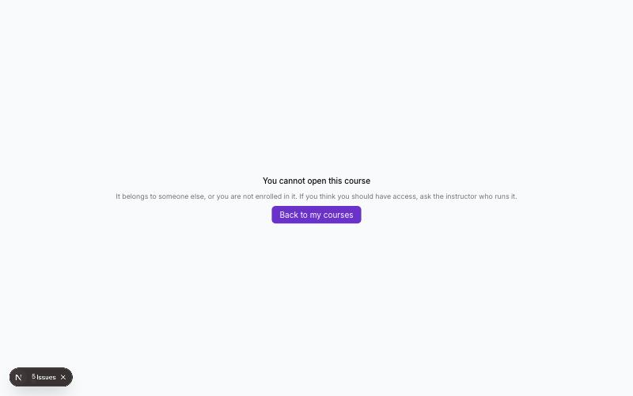

# Student Manual

**OpenMAIC teaching platform — Level 2**

---

*Signing in. There is no sign-up link: an administrator makes your account. If you forget your
password, they set a new one — there is no self-service reset.*

*What a student sees after signing in: only the courses they are enrolled in, each with the
instructor's name, when it was last used, and the course id. There is no button to make, edit or
delete anything, and no sign of any other student.*

*Typing the address of a course you are not enrolled in. The server refuses it — this is not the
page hiding a button — and says so in a sentence.*

## Signing in

Go to `/platform` and sign in with the email and password your instructor or administrator gave
you. You land on **My courses**.

If sign-in is refused and you are sure the password is right, your account may still be waiting for
an administrator to approve it. Ask your instructor.

---

## My courses

Each course you are enrolled in shows its title, who teaches it, its status and when it was last
active, with an **Open course** button that takes you into the classroom.

**If a course is missing**, one of these is true:

- your instructor has not enrolled you yet;
- your enrolment has been deactivated;
- the course has not been published.

Your instructor can see and fix all three.

---

## In the classroom

The classroom is OpenMAIC's own: the AI teacher presents the lesson while the notes panel follows
along, AI classmates take part, and you can ask questions in the chat.

Your work is saved as you go and is tied to your account, so you can come back to it later from any
browser by signing in.

---

## Your privacy

**What your instructor can see:** your activity in the courses you are enrolled in — when you were
active, how many interactions you have had, and the record of your conversation with the AI.

**What nobody else can see:** your work is yours. Another student cannot read your conversation,
your answers or your progress, and cannot submit work as you. This is enforced by the server, not
by the design of the page: a request that tries is refused outright.

**What is not stored:** the platform does not export or share passwords or credentials.

---

## What you cannot do, and why

You cannot create or edit courses, change the AI agents, see other students, or reach provider
settings. These are instructor and administrator functions. They are not merely hidden from your
screen — the server refuses them, so there is nothing to be gained by looking for a way around the
interface.

---

## Signing out

**Sign out** at the top right ends your session. Use it on a shared or public computer; otherwise
the next person at that browser would still be signed in as you.

---

# Answering and revising (Level 3B)

Some activities ask you to write an answer rather than chat.

**Your answers are never overwritten.** When you revise one, the new version is stored beside the
old one and both are kept. Your instructor can see every attempt. That is on purpose: how an answer
changed is often more interesting than the final one.

## Feedback

Whether you can get feedback, and when, is set by your instructor for each activity. You may find:

- feedback whenever you ask for it;
- feedback only after your first attempt — so that first answer is yours alone;
- feedback only after you submit;
- no feedback at all.

If feedback is not available the system says so in a sentence, rather than failing silently.

Feedback aims at the weakest part of what you actually wrote, and it will not simply repeat what it
told you last time. It will not give you the answer.

## Being scored

Your answer may be scored against a rubric — a list of things the work is judged on. A first score
may come from the AI, but **it is not final until a human has looked at it**. Your instructor can
accept it, change it, or throw it away, and their decision is what counts.

## What is recorded about you

Your answers, your revisions, the feedback you were given, and the scores. Your instructor sees
this for their own course and nobody else's.

If your course is part of a research study, researchers see this data **without your name**, as a
participant number, and only if you have consented. Using the platform for your course and being
part of a study are separate things.
